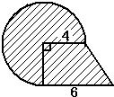

# Mathematics (Grade 6)

**ID**: 18d7ba50
**难度**: medium_hard
**题型**: short_answer

## 题目
求如图阴影部分的面积．单位：厘米．

## 解答

**答案**: 57.68

1. Step1:计算半径为4厘米的$\frac{3}{4}$圆的面积，根据圆的面积公式$S = \pi r^2$，可得$\frac{3}{4}$圆的面积为$3.14×4^2×\frac{3}{4}=3.14×4×3$
2. Step2:计算上底4厘米，下底6厘米，高4厘米的梯形的面积，根据梯形面积公式$S=(a + b)h÷2$，可得面积为$4 + 6×4÷2 = 20$
3. Step3:将$\frac{3}{4}$圆的面积与梯形的面积相加，即$3.14×4×3 + 20 = 37.68 + 20 = 57.68$

## 知识点

**知识点**:
  - 组合图形的面积．

---
