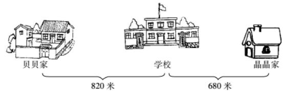

# Mathematics (Grade 6)

**ID**: 1a293e84
**难度**: medium_hard
**题型**: short_answer

## 题目

贝贝中午不回家，在学校吃饭；晶晶中午回家吃饭。每天上学及放学回家谁走的路多些？

## 解答

**答案**: 1640, 2720, 晶晶

1. Step1:分析贝贝的行程，由于中午不回家，所以每天走2个从家到学校的路程，即计算820×2得到贝贝每天走的路程为1640米
2. Step2:分析晶晶的行程，因为中午回家吃饭，所以每天走4个从家到学校的路程，即计算680×4得到晶晶每天走的路程为2720米
3. Step3:比较贝贝和晶晶每天走的路程大小，2720米＞1640米，得出晶晶走的路多

## 知识点

**知识点**:
  - 一位数乘两、三位数;万以内数的大小比较

---
