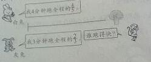

# Mathematics (Grade 6)

**ID**: 1b86f34a
**难度**: medium_hard
**题型**: short_answer

## 题目
比比谁跑得快？      

## 解答

**答案**: 灰兔快

1. Step1:将路程看作单位“1”，计算白兔的速度，根据速度 = 路程÷时间，白兔4分钟跑全程的$rac{4}{5}$，则白兔速度为$rac{4}{5}÷4=rac{1}{5}$
2. Step2:计算灰兔的速度，灰兔3分钟跑全程的$rac{2}{3}$，则灰兔速度为$rac{2}{3}÷3=rac{2}{9}$
3. Step3:对$rac{1}{5}$和$rac{2}{9}$进行通分，$rac{1}{5}=rac{1×9}{5×9}=rac{9}{45}$，$rac{2}{9}=rac{2×5}{9×5}=rac{10}{45}$
4. Step4:比较通分后两个分数的大小，$rac{10}{45}>rac{9}{45}$，即$rac{2}{9}>rac{1}{5}$
5. Step5:因为灰兔速度大于白兔速度，所以得出结论灰兔快

## 知识点

**知识点**:
  - --

---
