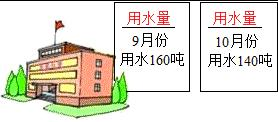

# Mathematics (Grade 6)

**ID**: 1b8d011a
**难度**: medium_hard
**题型**: short_answer

## 题目

(1)10月份比9月份节约用水百分之几？
(2)如果11月份比10月份节约用水5%，每吨水费为2元，11月份应付水费多少元？

## 解答

**答案**: 12.5%, 266

1. Step1:计算10月份比9月份少用水的吨数，即160 - 140 = 20吨
2. Step2:计算10月份比9月份节约用水的百分比，用少用的吨数除以9月份的用水量，即20÷160 = 12.5%
3. Step3:计算11月份的用水量，把10月份用水量140吨看成单位“1”，11月份用水量为140×(1 - 5%) = 140×95% = 133吨
4. Step4:计算11月份应付的水费，每吨水费2元，11月份水费为133×2 = 266元

## 知识点

**知识点**:
  - 百分数的实际应用．

---
