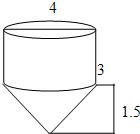

# Mathematics (Grade 6)

**ID**: 1c142ab6
**难度**: medium_hard
**题型**: short_answer

## 题目
(选做题)计算下面图形的体积．(单位：厘米)

## 解答

**答案**: 43.96

1. Step1:先计算圆柱体积，圆柱底面半径为4÷2 = 2厘米，高为3厘米，根据圆柱体积公式V = πr²h，可得圆柱体积为3.14×2²×3 = 37.68立方厘米
2. Step2:再计算圆锥体积，圆锥底面半径同样为4÷2 = 2厘米，高为1.5厘米，根据圆锥体积公式V = 1/3×πr²h，可得圆锥体积为1/3×3.14×2²×1.5 = 6.28立方厘米
3. Step3:最后将圆柱体积与圆锥体积相加，37.68 + 6.28 = 43.96立方厘米，得到图形体积

## 知识点

**知识点**:
  - 组合图形的体积．

---
