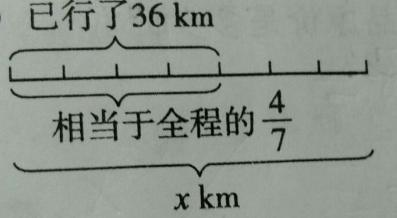

# Mathematics (Grade 6)

**ID**: 1ccfda1f
**难度**: medium_hard
**题型**: short_answer

## 题目
根据线段图列式计算.

 已行了36km
 相当于全程的
 $\frac{4}{7}$
 xkm

## 解答

**答案**: 63

1. Step1:设全程为xkm，因为已行的36km相当于全程的$\frac{4}{7}$，根据分数乘法的意义可得$\frac{4}{7}x = 36$
2. Step2:为求出x，等式两边同时除以$\frac{4}{7}$，即$x = 36\div\frac{4}{7}$
3. Step3:根据除法运算法则，$36\div\frac{4}{7}=36	imes\frac{7}{4}$
4. Step4:计算$36	imes\frac{7}{4}=63$，所以全程x为63km

## 知识点

**知识点**:
  - --

---
