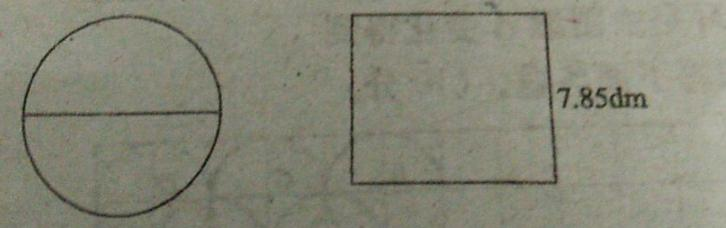

# Mathematics (Grade 6)

**ID**: 2347f2ba
**难度**: medium_hard
**题型**: short_answer

## 题目
图中 一个长方形的面积和一个圆的面积相等，已知圆周长是31.4dm，求出长方形的长.

 31.4dm，7.85dm

## 解答

**答案**: 10分米

1. Step1:根据圆的周长公式$C = 2\pi r$（其中$C$为周长，$r$为半径，$\pi$取3.14），由圆周长31.4dm计算圆的半径，即$r = 31.4÷3.14÷2 = 5dm$
2. Step2:根据圆的面积公式$S = \pi r^2$（其中$S$为面积，$r$为半径，$\pi$取3.14），计算圆的面积为$3.14×5^2 = 78.5$平方分米
3. Step3:因为长方形面积和圆面积相等，已知长方形的宽是7.85dm，根据长方形的面积公式$S = a×b$（其中$S$为面积，$a$为长，$b$为宽），计算长方形的长为$78.5÷7.85 = 10$分米

## 知识点

**知识点**:
  - --

---
