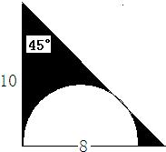

# Mathematics (Grade 6)

**ID**: 23abfb7c
**难度**: medium_hard
**题型**: short_answer

## 题目
求如图阴影部分的面积；（单位：cm）

## 解答

**答案**: 24.88

1. Step1:根据题意，明确阴影部分面积的计算方法为阴影部分的面积=三角形的面积-半圆的面积
2. Step2:因为三角形是等腰直角三角形，直角边为10厘米，根据三角形面积公式S = a×a÷2（a为直角边），可得三角形面积为10×10÷2 = 50平方厘米
3. Step3:已知半圆的直径为8厘米，那么半径为8÷2 = 4厘米，根据圆的面积公式S = πr²，可得半圆的面积为3.14×4²÷2 = 3.14×16÷2 = 25.12平方厘米
4. Step4:用三角形面积减去半圆面积，即50 - 25.12 = 24.88平方厘米，得到阴影部分面积

## 知识点

**知识点**:
  - 组合图形的面积．

---
