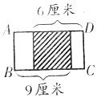

# Mathematics (Grade 6)

**ID**: 2665874b
**难度**: medium_hard
**题型**: short_answer

## 题目
如图，阴影部分是正方形，求长方形ABCD的周长．

## 解答

**答案**: 30（厘米）

1. Step1:分析图形可知，上面的6厘米加上下面的9厘米，比长方形ABCD的长多了一条中间正方形的边长，且正方形边长与长方形ABCD的宽相等
2. Step2:由此得出6 + 9 = 15厘米是长方形ABCD的一条长与一条宽的和
3. Step3:根据长方形周长公式，长方形周长=(长+宽)×2，所以长方形ABCD的周长为15×2
4. Step4:计算15×2 = 30厘米，得出长方形ABCD的周长是30厘米

## 知识点

**知识点**:
  - 长方形的周长

---
