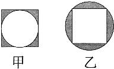

# Mathematics (Grade 6)

**ID**: 2743356b
**难度**: medium_hard
**题型**: short_answer

## 题目
甲、乙两图中的正方形的面积都是40cm$^{2}$，阴影部分的面积哪一块大？大多少？

## 解答

**答案**: 8.6, 22.8, 14.2

1. Step1:设甲图中圆的半径是r，那么甲图中正方形的边长是2r，因为正方形面积是40平方厘米，所以r² = 40÷4 = 10，进而得出甲图中圆的面积是3.14×10 = 31.4平方厘米，甲图阴影部分面积为40 - 31.4 = 8.6平方厘米
2. Step2:得出乙图中圆的半径的平方是40÷2 = 20，所以乙图中圆的面积是3.14×20 = 62.8平方厘米，乙图阴影部分面积为62.8 - 40 = 22.8平方厘米
3. Step3:计算乙图阴影部分面积与甲图阴影部分面积的差值，即22.8 - 8.6 = 14.2平方厘米

## 知识点

**知识点**:
  - 组合图形的面积；立体图形的容积．

---
