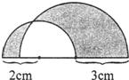

# Mathematics (Grade 6)

**ID**: 2aede4b9
**难度**: medium_hard
**题型**: short_answer

## 题目
半径分别是3cm和2cm的两个半圆，如图放置，求阴影部分的周长．

## 解答

**答案**: 19.7

1. Step1:根据圆的周长公式C = 2πr（C表示圆的周长，r表示半径，π取3.14），计算半径为3cm的半圆的弧长，即3.14×3×2÷2 = 9.42cm
2. Step2:计算半径为2cm的半圆的弧长，即3.14×2×2÷2 = 6.28cm
3. Step3:确定大半圆的半径为3cm
4. Step4:计算小半圆的直径，2×2 = 4cm
5. Step5:根据阴影部分的周长=半径为3厘米和2厘米的半个圆的长+大半圆的半径+小半圆的直径-大半圆的半径，列式为9.42 + 6.28 + 3 + 4 - 3
6. Step6:计算上式结果，9.42 + 6.28 + 3 + 4 - 3 = 19.7cm

## 知识点

**知识点**:
  - 圆的周长

---
