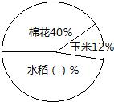

# Mathematics (Grade 6)

**ID**: 2af42f92
**难度**: medium_hard
**题型**: short_answer

## 题目
如图是大兴村几种农作物的种植面积统计图．水稻的种植面积是960公顷，三种农作物的种植面积一共是多少公顷．

## 解答

**答案**: 2000

1. Step1:把三种农作物的种植面积看作单位'1'
2. Step2:计算水稻占的比率，即1 - 40% - 12% = 48%
3. Step3:已知水稻种植面积为960公顷，根据已知部分求整体用除法，用960除以水稻占的比率48%，即960÷48% = 2000公顷得到三种农作物的总面积

## 知识点

**知识点**:
  - 扇形统计图

---
