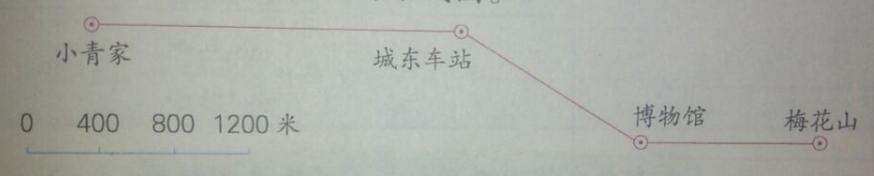

# Mathematics (Grade 6)

**ID**: 2b0d99d9
**难度**: medium_hard
**题型**: short_answer

## 题目
下面是小青从家到梅花山的路线图。

 0 400 800 1200米
 (1)小青家到梅花山的路程大约是多少千米？
 (2)小青早上8:00从家出发，以12千米/时的速度骑自行车去梅花山，需要多少分钟到达？

## 解答

**答案**: 2000(米), 216(分钟)

1. Step1:根据比例尺，量得小青家到城东车站距离为5厘米，其实际距离为5×400 = 2000米，此为小青家到梅花山路程中第一段的实际距离
2. Step2:量得城东车站到博物馆距离为3厘米，博物馆到梅花山距离为3厘米，那么小青家到梅花山的图上总距离为5 + 3 + 3 = 11厘米
3. Step3:根据比例尺计算小青家到梅花山的实际总距离为11×400 = 4400米 = 4.4千米
4. Step4:已知速度为12千米/时，根据时间 = 路程÷速度，将路程4.4千米代入，可得时间为4.4÷12小时
5. Step5:将4.4÷12小时换算为分钟，4.4÷12×60 = 216分钟

## 知识点

**知识点**:
  - --

---
