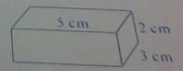

# Mathematics (Grade 6)

**ID**: 2b714b60
**难度**: medium_hard
**题型**: short_answer

## 题目
小明用这个长方体截成一个最大正方体，体积要比原来减少百分之几？

 5cm   2cm   3cm

## 解答

**答案**: 73.3

1. Step1:确定截得的最大正方体的棱长为2cm，根据正方体体积公式V=a³（a为棱长），可得正方体体积为2×2×2 = 8立方厘米
2. Step2:根据长方体体积公式V=abh（a、b、h分别为长方体的长、宽、高），计算长方体体积为5×3×2 = 30立方厘米
3. Step3:计算体积减少的值为30 - 8 = 22立方厘米
4. Step4:把长方体体积看作单位“1”，根据求比一个数少百分之几的公式，计算减少的百分比为22÷30×100%≈73.3%

## 知识点

**知识点**:
  - --

---
