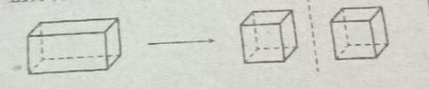

# Mathematics (Grade 6)

**ID**: 2fd6fdc7
**难度**: medium_hard
**题型**: short_answer

## 题目
把一根长方体木料截成两个完全相同的小正方体，表面积的总和比原来增加了72cm².这根木料长多少厘米？每个小正方体的体积是多少？

## 解答

**答案**: 12, 216

1. Step1:因为把长方体木料截成两个完全相同的小正方体，表面积增加的部分是两个正方形的面积，所以一个正方形面的面积为72÷2 = 36cm²
2. Step2:由正方形面积公式可知，正方形边长为对36开平方，即\(\sqrt{36}=6\)cm，此边长也就是小正方体的棱长
3. Step3:木料的长度是小正方体棱长的2倍，所以木料长度为6×2 = 12cm
4. Step4:根据正方体体积公式，每个小正方体的体积为6×6×6 = 216cm³

## 知识点

**知识点**:
  - 

---
