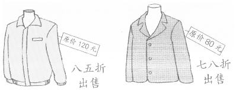

# Mathematics (Grade 6)

**ID**: 339303c2
**难度**: medium_hard
**题型**: short_answer

## 题目

（1）这件夹克的实际售价是多少元？
（2）买这件西服比原来便宜多少元？

## 解答

**答案**: 102, 17.6

1. Step1:已知夹克原价120元，打八五折出售，根据打几折就是按原价的百分之几十出售，所以用原价120乘以85%，即120×85%，得出夹克的实际售价为102元
2. Step2:已知西服原价80元，打七八折出售，先算出西服现价比原价便宜的百分比为1 - 78%，再用原价80乘以便宜的百分比，即80×(1 - 78%)，得出买西服比原来便宜17.6元

## 知识点

**知识点**:
  - 百分数的认识

---
