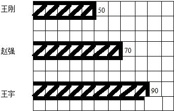

# Mathematics (Grade 6)

**ID**: 3458677b
**难度**: medium_hard
**题型**: short_answer

## 题目

上面是条形统计图是王刚、赵强、王宇三人收集邮票的枚数（单位：枚）
（1）一格表示多少枚？谁收集的枚数最多？谁收集的枚数最少？
（2）算一算他们三人平均每人收集邮票多少枚？

## 解答

**答案**: 10, 王宇, 王刚, 70

1. Step1:观察条形统计图，通过对比刻度可知一格表示10枚
2. Step2:比较三人收集邮票的数量50、70、90，得出王宇收集的枚数最多，王刚收集的枚数最少
3. Step3:计算三人收集邮票的总数，50 + 70 + 90 = 210枚
4. Step4:用总数除以人数3，210÷3 = 70枚，得到三人平均每人收集邮票的数量

## 知识点

**知识点**:
  - 从统计图表中获取信息

---
