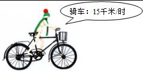

# Mathematics (Grade 6)

**ID**: 3580f89a
**难度**: medium_hard
**题型**: short_answer

## 题目
张老师从家骑车到学校要0.24小时，
（1）他家离学校有多远？
（2）如果他改为步行，每小时走5km，用0.8小时能到学校吗？

## 解答

**答案**: 3.6, 能

1. Step1:根据题目可知张老师骑车速度为15千米/时，从家骑车到学校用时0.24小时，由速度×时间=路程，可计算他家到学校的距离为15×0.24=3.6千米
2. Step2:已知张老师步行速度为每小时5千米，步行时间为0.8小时，根据速度×时间=路程，计算出步行0.8小时的路程为5×0.8=4千米
3. Step3:比较步行0.8小时的路程4千米和家到学校的距离3.6千米，因为4＞3.6，所以得出用0.8小时能到学校的结论

## 知识点

**知识点**:
  - 简单的行程问题

---
