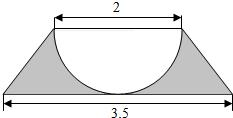

# Mathematics (Grade 6)

**ID**: 36466b4a
**难度**: medium_hard
**题型**: short_answer

## 题目
求阴影部分的面积（单位：厘米）

## 解答

**答案**: 1.18

1. Step1:计算半圆的半径，由直径2厘米可得半径为2÷2=1厘米
2. Step2:根据梯形面积公式S=(a + b)×h÷2（其中a=2厘米，b=3.5厘米，h=1厘米），计算梯形面积为(2 + 3.5)×1÷2=5.5÷2=2.75平方厘米
3. Step3:根据圆的面积公式S=πr²，计算半圆面积为3.14×1²÷2=3.14÷2=1.57平方厘米
4. Step4:用梯形面积减去半圆面积，即2.75 - 1.57 = 1.18平方厘米，得到阴影部分面积

## 知识点

**知识点**:
  - 组合图形的面积

---
