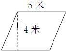

# Mathematics (Grade 6)

**ID**: 36cf801f
**难度**: medium_hard
**题型**: short_answer

## 题目
一块平行四边形的广告牌，每平方米大约要用油漆0.34千克，油漆工人带来15千克油漆，要刷完这块广告牌，这些油漆够吗？

## 解答

**答案**: 6.8(千克), 15(千克)

1. Step1:根据平行四边形面积公式S = 底×高，已知底为5米，高为4米，可得广告牌面积为5×4 = 20平方米
2. Step2:已知每平方米大约要用油漆0.34千克，用广告牌面积20平方米乘每平方米用漆量0.34千克，即20×0.34 = 6.8千克，得到刷这块广告牌总的用漆量
3. Step3:已知油漆工人带来15千克油漆，将总的用漆量6.8千克与15千克对比

## 知识点

**知识点**:
  - 平行四边形的面积．

---
