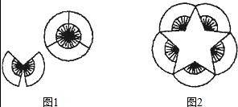

# Mathematics (Grade 6)

**ID**: 3ba952af
**难度**: medium_hard
**题型**: short_answer

## 题目
如图是由10把半径为30厘米的相同折扇组成的“蝴蝶花”(图1)和梅花图案(图2)(图中的折扇无重叠)，清清算出梅花图案五朵花瓣所占的面积．(不包括五角星的面积)

## 解答

**答案**: 4710

1. Step1:明确每把扇子半径为30厘米，根据圆的面积公式S = πr²，其中π取3.14，r = 30厘米，可得一个完整圆的面积为3.14×30²平方厘米
2. Step2:由3把扇子围成一个圆，可知每把扇子面积占围成圆面积的1/3
3. Step3:计算出每把扇子的面积为3.14×30²×1/3平方厘米
4. Step4:梅花图案有五朵花瓣，每朵花瓣由一把扇子构成，所以五朵花瓣面积为3.14×30²×1/3×5平方厘米
5. Step5:计算3.14×30²×1/3×5 = 3.14×900×1/3×5 = 3.14×300×5 = 942×5 = 4710平方厘米

## 知识点

**知识点**:
  - 圆、圆环的面积．

---
