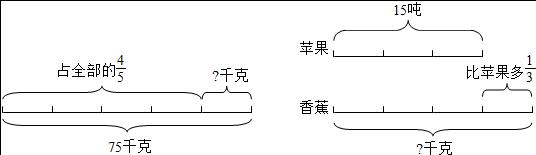

# Mathematics (Grade 6)

**ID**: 3c6f2295
**难度**: medium_hard
**题型**: short_answer

## 题目
看图列式计算．

## 解答

**答案**: 15, 20000

1. Step1:分析第一个图，把全部的看作单位“1”，已知占全部的$rac{4}{5}$，则所求部分占全部的1 - $rac{4}{5}$，已知全部为75千克，所以用75×(1 - $rac{4}{5}$)计算，即75×(1 - $rac{4}{5}$)=75×$rac{1}{5}$=15千克
2. Step2:分析第二个图，把苹果的15吨看作单位“1”，香蕉比苹果多$rac{1}{3}$，那么香蕉是苹果的1 + $rac{1}{3}$，所以求香蕉的重量用15×(1 + $rac{1}{3}$)计算，即15×(1 + $rac{1}{3}$)=15×$rac{4}{3}$=20吨
3. Step3:因为1吨 = 1000千克，所以将20吨换算为千克，20×1000 = 20000千克

## 知识点

**知识点**:
  - 图文应用题

---
