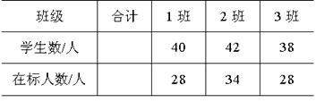

# Mathematics (Grade 6)

**ID**: 3cf1cec2
**难度**: medium_hard
**题型**: short_answer

## 题目
下面是六年级3个班级学生体育达标情况统计．

（1）先把表格填完整．
（2）分别求各班的体育达标率．(除不尽的百分号前保留一位小数)
（3）求六年级的体育达标率．

## 解答

**答案**: 120, 90, 70%, 81%, 73.7%, 75%

1. Step1:计算合计学生数，40 + 42 + 38 = 120
2. Step2:计算合计在标人数，28 + 34 + 28 = 90
3. Step3:计算1班体育达标率，28÷40×100% = 70%
4. Step4:计算2班体育达标率，34÷42×100% ≈ 81%
5. Step5:计算3班体育达标率，28÷38×100% ≈ 73.7%
6. Step6:计算六年级体育达标率，90÷120×100% = 75%

## 知识点

**知识点**:
  - 小学数学;数与代数;应用题;百分数应用题

---
