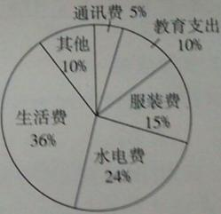

# Mathematics (Grade 6)

**ID**: 40d54bee
**难度**: medium_hard
**题型**: short_answer

## 题目
红红家去年的各项费用支出情况如下：

 通讯费5%  其他10%  生活费36%
 水电费24%  服装费15%  教育支出10%
 1．从统计图可以看出，哪项支出占总支出的比例最大？
 2．红红家去年总支出为6000元，其中用于教育支出的有多少元？
 3．生活费是教育支出的多少倍？

## 解答

**答案**: 生活费占总支出的比例最大, 600, 3.6

1. Step1:观察各项支出所占比例，通讯费5%，其他10%，生活费36%，水电费24%，服装费15%，教育支出10%，比较大小得出生活费支出占总支出的比例最大
2. Step2:已知红红家去年总支出为6000元，教育支出占总支出的10%，计算6000×10%=600元，得出教育支出的金额
3. Step3:已知生活费占总支出36%，教育支出占总支出10%，计算36%÷10%=3.6，得出生活费是教育支出的倍数

## 知识点

**知识点**:
  - --

---
