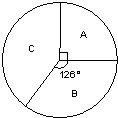

# Mathematics (Grade 6)

**ID**: 44f3b907
**难度**: medium_hard
**题型**: short_answer

## 题目
某校对1500名在校学生进行每周上网的情况调查，A为每天上网的学生，B为从不上网的学生，C为偶尔上网的学生，如扇形统计图所示．请根据图上信息，解答以下问题：
（1）B类学生占全校学生的百分之几？
（2）偶尔上网的学生有多少人？

## 解答

**答案**: $\frac{7}{20}$, 600

1. Step1:求B类学生占全校学生的百分比，由圆周角是360°，用B类学生对应的圆心角126°除以360°，即126÷360=$rac{7}{20}$
2. Step2:求C类学生对应的圆心角，用360°减去A类学生对应的90°和B类学生对应的126°，即360°-90°-126°=144°
3. Step3:求偶尔上网（C类）的学生人数，用C类学生对应的圆心角144°除以360°得到C类学生占比，再乘以总人数1500，即$rac{144}{360}$×1500=600人

## 知识点

**知识点**:
  - 扇形统计图．

---
