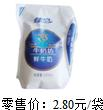

# Mathematics (Grade 6)

**ID**: 4760782f
**难度**: medium_hard
**题型**: short_answer

## 题目
笑笑家五月份每天预定3袋鲜牛奶，按批发价共付232.5元．每袋鲜牛奶可比零售价便宜多少元？

## 解答

**答案**: 0.3

1. Step1:明确五月份的天数为31天
2. Step2:计算五月份预定牛奶的总袋数，即3×31 = 93袋
3. Step3:计算每袋牛奶的批发价，即232.5÷93 = 2.5元
4. Step4:已知每袋牛奶零售价为2.80元，计算每袋鲜牛奶比零售价便宜的金额，即2.80 - 2.5 = 0.3元

## 知识点

**知识点**:
  - 图文应用题；整数、小数复合应用题．

---
