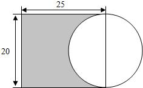

# Mathematics (Grade 6)

**ID**: 47f37ea9
**难度**: medium_hard
**题型**: short_answer

## 题目
求如图阴影部分的面积．单位：厘米 

## 解答

**答案**: 343

1. Step1:明确长方形的长为25厘米，宽为20厘米，根据长方形面积公式S = a×b（a为长，b为宽），可得长方形面积为20×25 = 500平方厘米
2. Step2:由图可知半圆的直径为20厘米，那么半径r = 20÷2 = 10厘米，根据圆的面积公式S = πr²，可得半圆的面积为（20÷2）²×3.14÷2 = 100×3.14÷2 = 157平方厘米
3. Step3:因为阴影部分的面积等于长方形的面积减去半圆的面积，所以阴影部分面积为500 - 157 = 343平方厘米

## 知识点

**知识点**:
  - 组合图形的面积．

---
