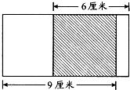

# Mathematics (Grade 6)

**ID**: 48867520
**难度**: medium_hard
**题型**: short_answer

## 题目
如图，在一个长方形中有一段阴影部分，如果阴影部分恰好是正方形，那么图中大长方形的周长是多少厘米？     

## 解答

**答案**: 30

1. Step1:根据图形可知，上面的6厘米加上下面的9厘米，比大长方形的长多了一条中间小正方形的边长，且小正方形边长与大长方形的宽相等
2. Step2:由此推出6 + 9 = 15厘米是大长方形一条长与一条宽的和
3. Step3:根据长方形周长公式，长方形周长=(长+宽)×2，所以大长方形周长为15×2
4. Step4:计算15×2 = 30厘米

## 知识点

**知识点**:
  - 巧算周长．

---
