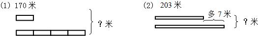

# Mathematics (Grade 6)

**ID**: 493a534e
**难度**: medium_hard
**题型**: short_answer

## 题目
列式计算

## 解答

**答案**: 850, 413

1. Step1:分析第一个图形，已知第一个长度为170米，第二个长度是第一个的4倍，先计算第二个长度为170×4，再求总长度为170×4 + 170 = 170×5 = 850米
2. Step2:分析第二个图形，已知第一个长度为203米，第二个比第一个多7米，先计算第二个长度为203 + 7，再求总长度为203 + 7 + 203 = 210 + 203 = 413米

## 知识点

**知识点**:
  - 图文应用题

---
