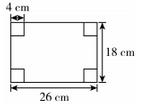

# Mathematics (Grade 6)

**ID**: 49cb7b0e
**难度**: medium_hard
**题型**: short_answer

## 题目
一块长方形硬纸板（如图），长是26厘米，宽是18厘米，把它的四个角分别减去边长为4厘米的正方形，然后把它制成一个无盖的长方体纸盒，这个无盖长方体纸盒能装得下750毫升的果汁吗？

## 解答

**答案**: 720立方厘米, 720毫升, 720毫升＜750毫升

1. Step1:计算长方体的长，26 - 4 - 4 = 18（厘米）
2. Step2:计算长方体的宽，18 - 4 - 4 = 10（厘米）
3. Step3:计算长方体的容积，18×10×4 = 720（立方厘米）
4. Step4:将立方厘米换算为毫升，720立方厘米 = 720毫升
5. Step5:比较容积与750毫升大小，720毫升＜750毫升

## 知识点

**知识点**:
  - 长、正方体体积的计算

---
