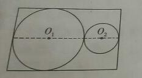

# Mathematics (Grade 6)

**ID**: 4bb3320c
**难度**: medium_hard
**题型**: short_answer

## 题目
下图中，大圆半径是4厘米，小圆半径是2厘米.这个长方形的周长和面积各是多少？

## 解答

**答案**: 40, 96

1. Step1:计算长方形的宽，根据大圆直径等于长方形宽，可得宽为4×2 = 8厘米
2. Step2:计算长方形的长，由大圆直径与小圆直径的和等于长方形长，即4×2 + 2×2 = 12厘米
3. Step3:根据长方形周长公式C=(a + b)×2（其中a为长，b为宽），计算周长为(12 + 8)×2 = 40厘米
4. Step4:根据长方形面积公式S = a×b（其中a为长，b为宽），计算面积为12×8 = 96平方厘米
5. Step5:提取周长的数值40和面积的数值96组成列表['40', '96']

## 知识点

**知识点**:
  - --

---
