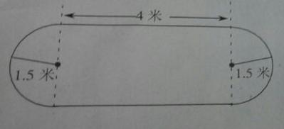

# Mathematics (Grade 6)

**ID**: 4c17db7b
**难度**: medium_hard
**题型**: short_answer

## 题目
学校要在围墙上做一个橱窗(如图)，这个橱窗的周长是多少米?面积是多少平方米?

## 解答

**答案**: 17.42, 19.065

1. Step1:明确圆的半径r = 1.5米，长方形的长a = 4米
2. Step2:计算长方形的宽为2×r = 2×1.5 = 3米
3. Step3:根据周长公式C = 2πr + 2a，代入r = 1.5米，a = 4米，π取3.14，可得C = 2×3.14×1.5 + 4×2 = 17.42米
4. Step4:根据面积公式S = πr² + (2r)a，代入r = 1.5米，a = 4米，π取3.14，可得S = 3.14×1.5² + 2×1.5×4 = 19.065平方米

## 知识点

**知识点**:
  - 

---
