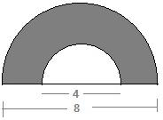

# Mathematics (Grade 6)

**ID**: 4fe19313
**难度**: medium_hard
**题型**: short_answer

## 题目
求阴影部分的面积（单位：厘米）

## 解答

**答案**: 18.84

1. Step1:计算小圆半径，根据小圆直径为4厘米，可得小圆半径为4÷2 = 2厘米
2. Step2:计算大圆半径，根据大圆直径为8厘米，可得大圆半径为8÷2 = 4厘米
3. Step3:根据圆的面积公式S = πr²，计算大圆面积为3.14×4² = 50.24平方厘米
4. Step4:根据圆的面积公式S = πr²，计算小圆面积为3.14×2² = 12.56平方厘米
5. Step5:计算大圆面积与小圆面积的差，即50.24 - 12.56 = 37.68平方厘米
6. Step6:因为阴影部分面积是（大圆面积 - 小圆面积）÷2，所以阴影部分面积为37.68÷2 = 18.84平方厘米

## 知识点

**知识点**:
  - 组合图形的面积

---
