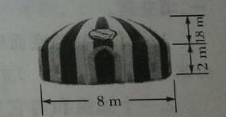

# Mathematics (Grade 6)

**ID**: 5011339c
**难度**: medium_hard
**题型**: short_answer

## 题目
一个临时帐篷由一个近似的圆柱和一个近似的圆锥组成，如下图.这个帐篷所占的空间大约是多少立方米？

 8m   2m   1.8m

## 解答

**答案**: 130.624

1. Step1:计算圆柱底面半径，由图可知底面直径为8m，半径r = 8÷2 = 4m
2. Step2:计算圆柱体积，根据圆柱体积公式V1 = πr²h，其中h = 2m，π取3.14，所以V1 = 3.14×4²×2 = 100.48m³
3. Step3:计算圆锥体积，根据圆锥体积公式V2 = 1/3πr²h，其中h = 1.8m，π取3.14，所以V2 = 3.14×4²×1.8÷3 = 30.144m³
4. Step4:计算帐篷所占空间，即圆柱体积与圆锥体积之和，V = V1 + V2 = 100.48 + 30.144 = 130.624m³

## 知识点

**知识点**:
  - 

---
