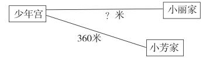

# Mathematics (Grade 6)

**ID**: 5252f467
**难度**: medium_hard
**题型**: short_answer

## 题目
小丽每分钟走68米，小芳每分钟走72米。

小丽从家到少年宮比小芳多走3分钟，小丽家离少年宮多少米？

## 解答

**答案**: 544

1. Step1:根据路程和小芳的速度，计算小芳从家到少年宫所用时间，即360÷72 = 5（分）
2. Step2:因为小丽从家到少年宫比小芳多走3分钟，所以小丽从家到少年宫所用时间为5 + 3 = 8（分）
3. Step3:根据小丽的速度和所用时间，计算小丽家离少年宫的距离，即68×8 = 544（米）

## 知识点

**知识点**:
  - 整数的四则混合运算

---
