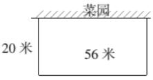

# Mathematics (Grade 6)

**ID**: 526fbcc9
**难度**: medium_hard
**题型**: short_answer

## 题目
如图，要靠墙围一个长方形菜园，用总长100米的围栏，够吗？

## 解答

**答案**: 96, 100, 够

1. Step1:根据图形可知长方形菜园宽为20米，长为56米，且一面靠墙，靠墙的是长，所以计算所需围栏长度时只算两条宽和一条长
2. Step2:计算所需围栏长度，列式为20×2 + 56 = 96米
3. Step3:已知提供的围栏总长为100米
4. Step4:比较所需围栏长度96米和提供的围栏总长100米的大小，96＜100，得出结论够

## 知识点

**知识点**:
  - 长方形与正方形的周长

---
