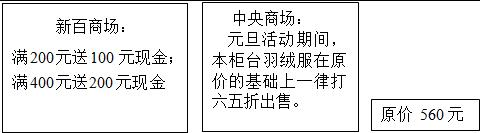

# Mathematics (Grade 6)

**ID**: 5277a015
**难度**: medium_hard
**题型**: short_answer

## 题目
下面是新百商场、中央商场在元旦期间，波司登羽绒服促销活动的商品信息：

你认为到哪个商场购买这种羽绒服比较便宜？先计算再回答．

## 解答

**答案**: 360元, 364元, 新百商场

1. Step1:判断在新百商场购买时的返现情况，因为560元＞400元，所以返200元现金
2. Step2:计算在新百商场购买羽绒服的花费，560 - 200 = 360元
3. Step3:计算在中央商场购买羽绒服的花费，560×65% = 364元
4. Step4:比较两个商场购买羽绒服的花费，360元＜364元
5. Step5:得出结论，在新百商场购买比较便宜

## 知识点

**知识点**:
  - 最优化问题．

---
