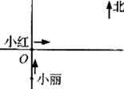

# Mathematics (Grade 6)

**ID**: 57053c46
**难度**: medium_hard
**题型**: short_answer

## 题目
如图所示，两条路线垂直相交，交点是O，小丽在O点的南侧480m处，沿南北方向向北走，小红在O点，沿东西方向向东走，两人同时出发，4分钟时两人距交点O的距离相等；继续行走，又经过12分钟，两人距交点的距离又相等。她们两人每分钟各行多少米?

## 解答

**答案**: 45, 75

1. Step1:根据'小红4分钟走的路程，正是小丽到O点还要走的路程'，可知两人4分钟行的路程和是480m，计算速度和为480÷4 = 120米/分
2. Step2:由'继续行走，又经过12分钟，两人距交点的距离又相等'，得出(4 + 12)分钟小丽比小红多行480m，计算速度差为480÷(4 + 12) = 30米/分
3. Step3:根据和差问题公式，计算小丽的速度为(120 + 30)÷2 = 75米/分
4. Step4:计算小红的速度为75 - 30 = 45米/分
5. Step5:提取小红速度45米/分的数值45
6. Step6:提取小丽速度75米/分的数值75
7. Step7:将小红速度数值45和小丽速度数值75组成列表['45', '75']

## 知识点

**知识点**:
  - 小学数学;图形与几何;位置与方向;根据方向、角度和距离确定物体的位置

---
