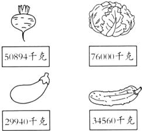

# Mathematics (Grade 6)

**ID**: 577daa4c
**难度**: medium_hard
**题型**: short_answer

## 题目
如图是李庄大棚蔬菜的产量，请把各种蔬菜的重量按从重到轻的顺序排列．

## 解答

**答案**: 76000千克, 50894千克, 34560千克, 29940千克

1. Step1:明确任务是对不同蔬菜的重量进行从重到轻排序，且单位都是千克，只需比较数字大小
2. Step2:比较 76000、50894、34560、29940 这几个数字的大小，得出 76000 最大
3. Step3:在剩下的数字 50894、34560、29940 中，比较得出 50894 次之
4. Step4:继续在剩下的 34560、29940 中比较，得出 34560 大于 29940
5. Step5:按照比较结果，将蔬菜重量按从重到轻排列为 76000 千克＞50894 千克＞34560 千克＞29940 千克，提取出对应的重量值组成列表

## 知识点

**知识点**:
  - 质量的单位换算；整数大小的比较．

---
