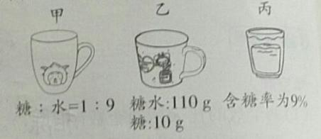

# Mathematics (Grade 6)

**ID**: 585d84ee
**难度**: medium_hard
**题型**: short_answer

## 题目
下面不同杯子中糖和水的质量比是不同的。
 哪杯糖水最甜？哪杯糖水口味最淡？为什么？

 甲
 糖:水=1:9
 乙
 糖水：110g
 糖：10g
 丙
 含糖率为9%

## 解答

**答案**: 甲的最甜，乙的最淡。

1. Step1:计算甲杯的含糖率，甲杯中糖:水 = 1:9，那么糖占糖水的比例为1÷(1 + 9)×100% = 10%
2. Step2:计算乙杯的含糖率，乙杯中糖水110g，糖10g，含糖率为10÷110×100%≈9.1%
3. Step3:已知丙杯含糖率为9%
4. Step4:比较三杯糖水的含糖率，9% < 9.1% < 10%
5. Step5:得出结论，含糖率越高越甜，所以甲的最甜，乙的最淡

## 知识点

**知识点**:
  - --

---
