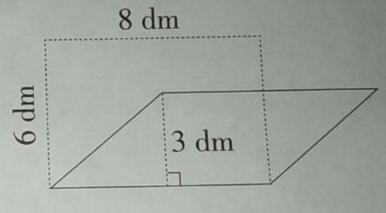

# Mathematics (Grade 6)

**ID**: 5a059307
**难度**: medium_hard
**题型**: short_answer

## 题目
把一个长8分米,宽6分米的长方形拉成一个平行四边形后,测得平行四边形的高是3分米(如图).平行四边形的面积比长方形的面积减少了多少平方分米?

 6dm       8dm     3dm

## 解答

**答案**: 24

1. Step1:根据长方形面积公式，长方形面积=长×宽，已知长方形长8分米，宽6分米，所以长方形面积为8×6=48平方分米
2. Step2:根据平行四边形面积公式，平行四边形面积=底×高，本题中平行四边形底边长等于长方形的长为8分米，高是3分米，所以平行四边形面积为8×3=24平方分米
3. Step3:用长方形面积减去平行四边形面积，即48 - 24 = 24平方分米，得到平行四边形的面积比长方形的面积减少的部分

## 知识点

**知识点**:
  - --

---
