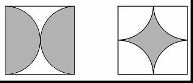

# Mathematics (Grade 6)

**ID**: 5b14fd04
**难度**: medium_hard
**题型**: short_answer

## 题目
如图中，两个正方形的边长均为6cm，求这两个图形中阴影部分的周长．

## 解答

**答案**: 20.84, 18.84

1. Step1:分析图（1），其阴影部分周长由圆的周长和两条正方形的边长组成，圆的直径等于正方形边长为6cm，根据圆的周长公式C = πd（d为直径），可得圆的周长为3.14×6cm，正方形边长为6cm，两条边长为6×2cm，所以图（1）阴影部分周长为3.14×6 + 6×2cm
2. Step2:计算3.14×6 + 6×2的值，3.14×6 = 18.84，6×2 = 12，18.84 + 12 = 20.84cm
3. Step3:分析图（2），其阴影部分周长等于圆的周长，圆的直径等于正方形边长为6cm，根据圆的周长公式C = πd，可得圆的周长为3.14×6cm
4. Step4:计算3.14×6的值为18.84cm

## 知识点

**知识点**:
  - 圆、圆环的周长

---
