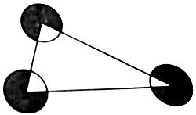

# Mathematics (Grade 6)

**ID**: 5d29e1fa
**难度**: medium_hard
**题型**: short_answer

## 题目
如图，三个半径为2厘米的圆的圆心正好在三角形的三个顶点上，你能分别求出阴影部分的周长和面积吗？

## 解答

**答案**: 43.4, 31.4

1. Step1:根据三角形内角和为180°，可知阴影部分周长计算思路为三个圆的周长之和减去圆周长的一半，再加上6条半径。
2. Step2:先计算三个圆的周长之和，圆的周长公式为C = 2πr，这里r = 2厘米，所以三个圆周长之和为3.14×2×2×3。
3. Step3:计算减去的圆周长的一半，即3.14×2×2÷2。
4. Step4:计算6条半径的长度，每条半径2厘米，6条半径长度为2×6。
5. Step5:将上述结果代入周长计算公式3.14×2×2×3 - 3.14×2×2÷2 + 2×6，得出周长为43.4厘米。
6. Step6:根据三角形内角和为180°，可知阴影部分面积计算思路为3个圆的面积之和减去半圆的面积。
7. Step7:计算3个圆的面积之和，圆的面积公式为S = πr²，这里r = 2厘米，所以3个圆面积之和为3.14×2²×3。
8. Step8:计算减去的半圆的面积，即3.14×2²÷2。
9. Step9:将上述结果代入面积计算公式3.14×2²×3 - 3.14×2²÷2，得出面积为31.4平方厘米。
10. Step10:整理结果得到['43.4', '31.4']

## 知识点

**知识点**:
  - 组合图形的面积;圆、圆环的周长;圆、圆环的面积

---
