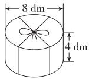

# Mathematics (Grade 6)

**ID**: 5decfe68
**难度**: medium_hard
**题型**: short_answer

## 题目
今天是小明的生日，妈妈送给他一个大蛋糕， 蛋糕盒是圆柱形的，现在用丝带将它捆扎起来（如图），需要多长的丝带呢？（扎蝴蝶结用15dm）

## 解答

**答案**: 63

1. Step1:明确丝带长度组成部分，包括捆扎处丝带长度和蝴蝶结长度
2. Step2:计算捆扎处丝带长度，由圆柱底面4条直径和4条高组成，底面直径为8dm，高为4dm，所以捆扎处丝带长度为(8 + 4)×4
3. Step3:计算总的丝带长度，将捆扎处丝带长度与蝴蝶结长度15dm相加，即(8 + 4)×4 + 15
4. Step4:计算(8 + 4)×4 + 15的结果，先算(8 + 4)×4 = 48，再算48 + 15 = 63

## 知识点

**知识点**:
  - 圆柱的认识

---
