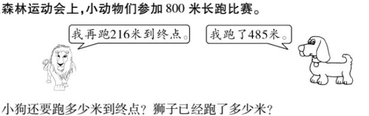

# Mathematics (Grade 6)

**ID**: 5f453ee9
**难度**: medium_hard
**题型**: short_answer

## 题目

森林运动会上，小动物们参加800米长跑比赛。
狮子：我再跑216米到终点。
小狗：我跑了485米。
小狗还要跑多少米到终点？狮子已经跑了多少米？

## 解答

**答案**: 315, 584

1. Step1:明确总路程为800米，小狗已跑485米，根据总长-已跑的米数=剩下的米数，可得小狗还要跑的距离为800 - 485
2. Step2:计算800 - 485 = 315米
3. Step3:明确狮子再跑216米到终点，即狮子剩下216米没跑，根据总长-剩下的米数=已跑的米数，可得狮子已经跑的距离为800 - 216
4. Step4:计算800 - 216 = 584米

## 知识点

**知识点**:
  - 整数的加法和减法

---
