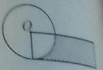

# Mathematics (Grade 6)

**ID**: 61e0139c
**难度**: medium_hard
**题型**: short_answer

## 题目
右图中圆周长是16.4厘米,圆面积与长方形面积正好相等,求阴影部分的周长是多少?

## 解答

**答案**: 20.5厘米

1. Step1:根据圆的周长公式$C = 2\pi r$（$C$为周长，$r$为半径），由圆周长$16.4$厘米，可得圆的半径为$16.4\div\pi\div2=rac{8.2}{\pi}$厘米，此半径也是长方形的宽。
2. Step2:根据圆的面积公式$S = \pi r^2$，将半径$rac{8.2}{\pi}$代入，可得圆的面积为$\pi	imes(rac{8.2}{\pi})^2=rac{8.2^2}{\pi}$平方厘米，此面积也是长方形的面积。
3. Step3:因为长方形面积$S = a	imes b$（$a$为长，$b$为宽），已知长方形面积为$rac{8.2^2}{\pi}$平方厘米，宽为$rac{8.2}{\pi}$厘米，所以长方形的长为$rac{8.2^2}{\pi}\divrac{8.2}{\pi}=8.2$厘米。
4. Step4:根据$阴影部分的周长=长方形的两个长+圆的周长×rac{1}{4}$，长方形长为$8.2$厘米，圆周长为$16.4$厘米，可得阴影部分周长为$8.2×2 + 16.4×rac{1}{4}=20.5$厘米。

## 知识点

**知识点**:
  - 

---
