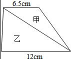

# Mathematics (Grade 6)

**ID**: 636ec366
**难度**: medium_hard
**题型**: short_answer

## 题目
求图中三角形甲和三角形乙的面积比．

## 解答

**答案**: 13：24

1. Step1:由图可知三角形甲和三角形乙的高相等，都等于梯形的高
2. Step2:根据三角形面积公式S = 1/2ah（a为底，h为高），因为高h相同，所以面积比等于底边长之比
3. Step3:三角形甲的底边长为6.5cm，三角形乙的底边长为12cm，其底边长比为6.5：12
4. Step4:将6.5：12化为整数比，即65：120
5. Step5:对65：120进行化简，(65÷5)：(120÷5)=13：24
6. Step6:得出三角形甲和三角形乙的面积比为13：24

## 知识点

**知识点**:
  - 比的意义;三角形的周长和面积

---
