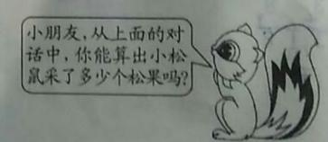

# Mathematics (Grade 6)

**ID**: 64457d45
**难度**: medium_hard
**题型**: short_answer

## 题目
小松鼠和爸爸、妈妈一起采回来一大堆松果，爸爸和妈妈都为小松鼠的进步而兴奋，松鼠爸爸和妈妈高兴地聊了起来．
 妈妈：我们的孩子越来越能干了，这些松果中有不少是他采的呢!你猜猜他采了多少个?
 爸爸：我猜他采的占25%，
 妈妈：比总数的25%还多15个呢!
 爸爸：差不多是
 $\frac{1}{3}$
  吧!妈妈：我和孩子一共采了120个．

 小朋友，从上面的对话中，你能算出小松鼠采了多少个松果吗?

## 解答

**答案**: 72

1. Step1:计算\(rac{1}{3}\)与25%的差值，即\(rac{1}{3} - 25\% = rac{1}{3} - rac{1}{4} = rac{1}{12}\)
2. Step2:因为小松鼠采的比总数的25%还多15个，且差不多是总数的\(rac{1}{3}\)，所以15个松果对应的分率是\(rac{1}{12}\)，由此可计算松果总数为\((15)÷rac{1}{12}=15×12 = 180\)个
3. Step3:根据妈妈说小松鼠采的比总数的25%还多15个，计算小松鼠采的松果数为\(180×25\% + 15 = 45 + 15 = 72\)个

## 知识点

**知识点**:
  - --

---
