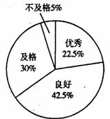

# Mathematics (Grade 6)

**ID**: 64728e0b
**难度**: medium_hard
**题型**: short_answer

## 题目
如图是六年级二班同学体育锻炼标准测试情况的统计图。已知不及格的同学有2个，那么得优秀的同学有多少人？

## 解答

**答案**: 9

1. Step1:根据不及格同学的人数和其所占比例，计算六年级二班总人数，即2÷5%=40人
2. Step2:根据总人数和优秀同学所占比例，计算优秀同学的人数，即40×22.5%=9人

## 知识点

**知识点**:
  - 百分数应用题

---
