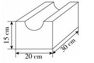

# Mathematics (Grade 6)

**ID**: 64c762ba
**难度**: medium_hard
**题型**: short_answer

## 题目
在长30cm、宽20cm、高15cm的长方体中挖去一个半径为5cm的圆柱的一半后得到如下图所示的几何体。该几何体的体积是多少？

## 解答

**答案**: 7822.5

1. Step1:根据长方体体积公式V=长×宽×高，计算长方体体积，即30×20×15=9000（cm³）
2. Step2:根据圆柱体积公式V=底面积×高，底面积S = πr²（r为半径），计算圆柱体积的一半，即3.14×5²×30÷2=1177.5（cm³）
3. Step3:用长方体体积减去圆柱体积的一半，得到该几何体体积，即9000 - 1177.5=7822.5（cm³）

## 知识点

**知识点**:
  - 长、正方体体积的计算;圆柱的体积

---
